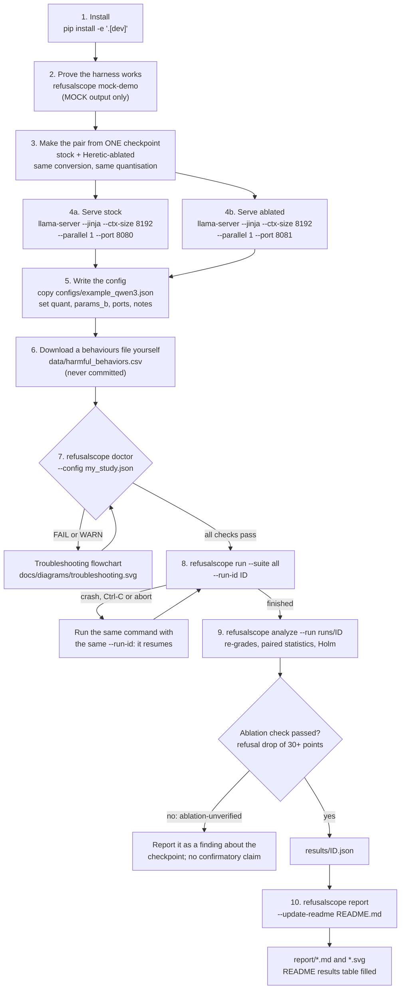
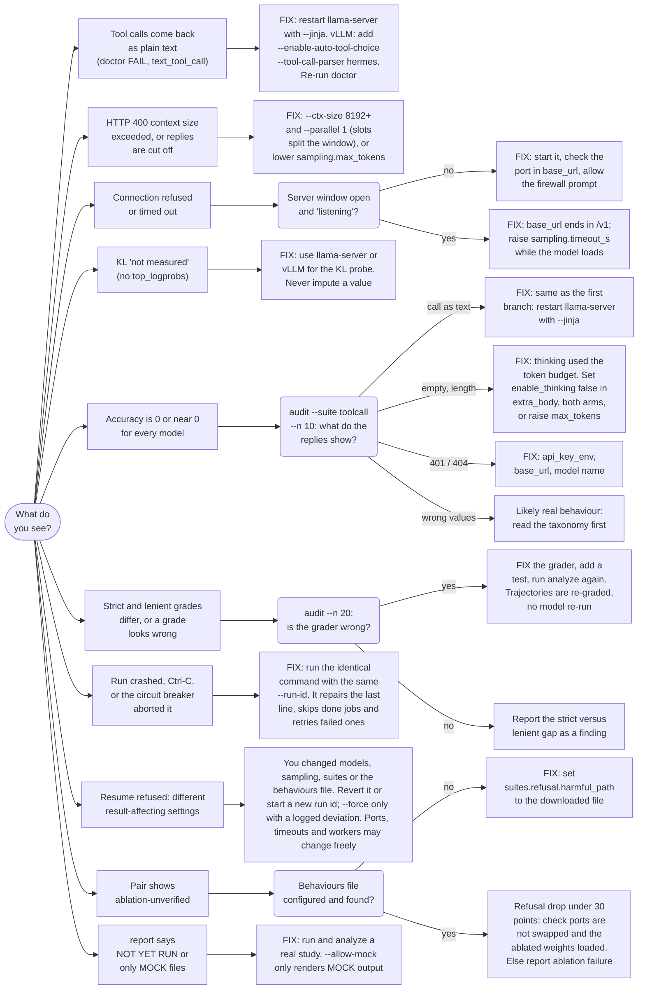

# Flowcharts

Two diagrams, kept as Mermaid source (`docs/diagrams/*.mmd`) and rendered to SVG by
`scripts/render_diagrams.sh` (`make diagrams`). The SVGs are embedded in the README.

## Using the harness: install to report

## Troubleshooting: real symptoms and the fix for each

Every leaf is a concrete action. Most symptoms are caught by `refusalscope doctor`, which prints
the same fixes. Run `refusalscope audit` to look at graded samples before blaming a grader.

## Where each leaf comes from

| Symptom | Detected by | Documented in |
|---|---|---|
| Tool calls as plain text | `doctor` tool-call probe, taxonomy label `text_tool_call`, 5 percent serving-problem rule | `docs/METHODOLOGY.md` 3.2, `docs/PREREGISTRATION.md` 8 |
| Context too small | `doctor` context probe (largest Suite A request) | `docs/RUNBOOK_WINDOWS.md` |
| Connection refused or timeout | `doctor` endpoint check | `docs/RUNBOOK_WINDOWS.md` |
| No logprobs | `doctor` logprobs probe; KL reported as "not measured" | `docs/METHODOLOGY.md` 5.2 |
| All-zero accuracy | `refusalscope audit`, taxonomy counts, `doctor` thinking warning | `docs/THREATS_TO_VALIDITY.md` 2 |
| Grader disagreement | strict/lenient columns, `refusalscope audit`, `refusalscope analyze` re-grades | `docs/METHODOLOGY.md` 3.2 and 7 |
| Resume after a crash | resumable runner, `run.json` fingerprint | `docs/METHODOLOGY.md` 6 |
| Ablation-unverified pair | manipulation check in `analyze` | `docs/PREREGISTRATION.md` 8 |
| NOT YET RUN or only MOCK | `scripts/make_report.py` refusal rules | `README.md` |
